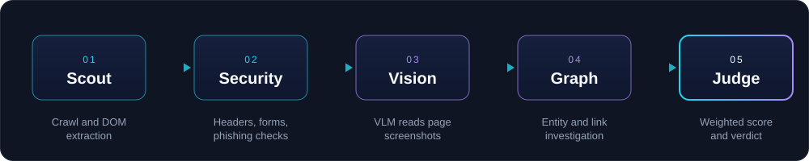

 

 

## About

I build AI systems that **take real actions**: multi-agent pipelines, retrieval systems, and the integrations that connect them to the tools people already use. My work sits where agent reasoning meets production reality, so I care about evidence, failure handling and observability as much as the model call itself.

 

## Featured projects

### [ELLIOT](https://github.com/Jinish2170/elliotAI) &nbsp;|&nbsp; Multi-agent forensic web auditor

An autonomous pipeline that audits a website for dark patterns, phishing signals and security gaps, then returns a scored trust report. Five specialised agents run on a LangGraph state machine, a vision-language model reads page screenshots, and progress streams live to the browser over WebSocket.

 

### [Bernard](https://github.com/Jinish2170/BenardAI) &nbsp;|&nbsp; Self-hosted AI threat triage

Drop a file or paste a URL and get a verdict where **every claim is cited to evidence**. Combines NVIDIA NIM inference with YARA rule matching, MITRE ATT&CK mapping and multiple threat-intelligence sources, so an analyst can verify the reasoning instead of trusting it.

 

### [Hybrid-RAG](https://github.com/Jinish2170/Hybrid-Rag) &nbsp;|&nbsp; Local-first retrieval pipeline

Vector search over your own documents with smart query routing and a web-search fallback when the local knowledge base falls short. The core pipeline runs on your machine with Ollama and Weaviate, so it needs no API keys and no cloud services.

 

## Production work

**Agentic support platform migration** (via Avrut Solutions)
Built the integrations that let an AI agent act on behalf of human support agents: Zendesk, Intercom, Front, Freshdesk, Shopify and Google Drive, including OAuth flows and webhooks. Also built Shopify Admin API tools (order creation, status changes) and handled the Shopify App Store listing.

 

## Toolbox

| | |
|---|---|
| **Agents and LLMs** | LangGraph, DSPy, LangChain, NVIDIA NIM, Ollama, tool-use and evaluation loops |
| **Retrieval and data** | Weaviate, Pinecone, LanceDB, PostgreSQL, Redis, embeddings and hybrid search |
| **Backend** | Python, FastAPI, TypeScript, Node.js, WebSockets, OAuth and webhook integrations |
| **Frontend** | React, Next.js, Tailwind CSS |
| **Automation** | Playwright, n8n |

 

Surat, India &nbsp;|&nbsp; Computer Engineering, GTU 2026

